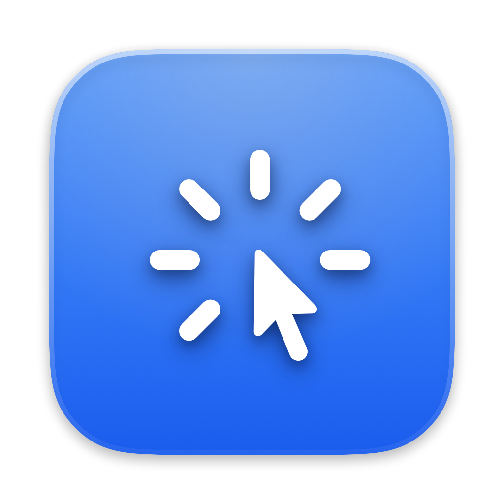
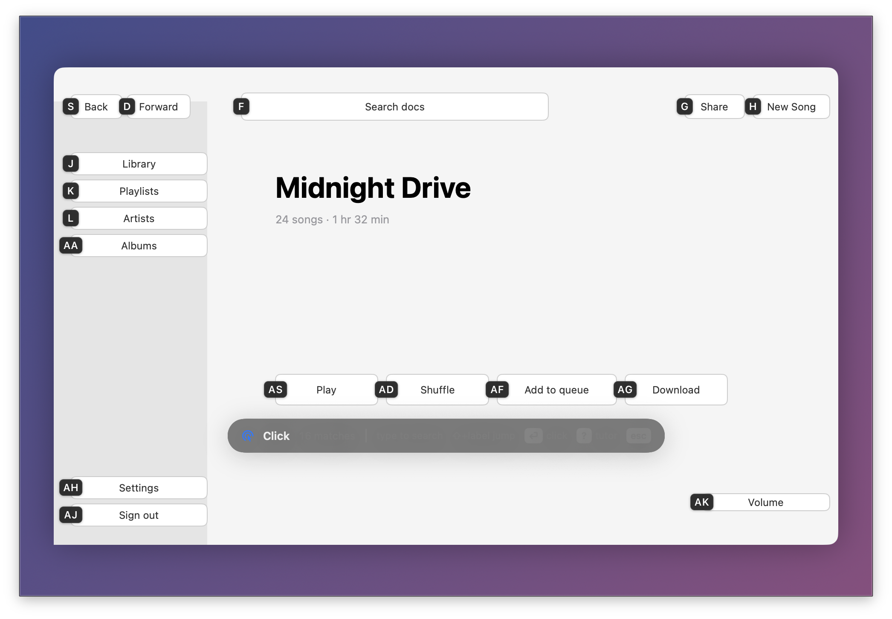
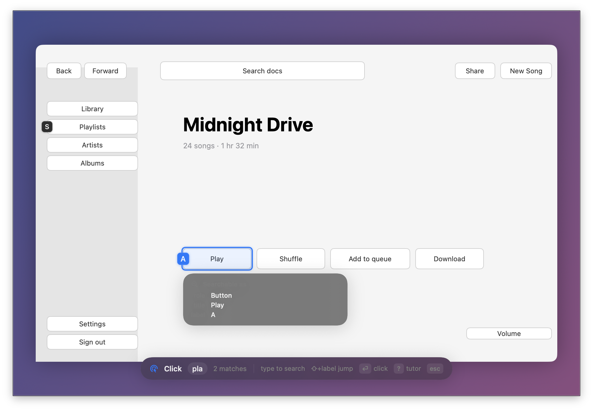
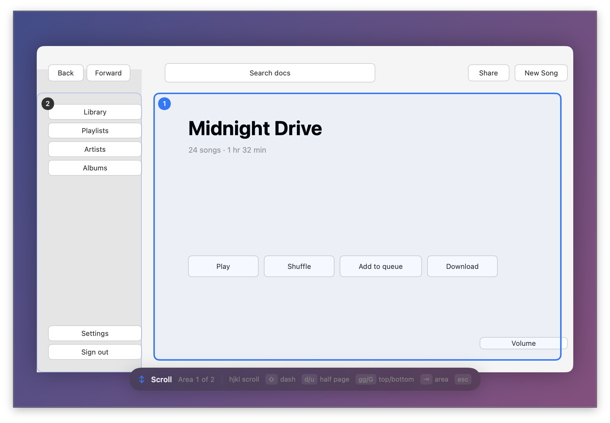
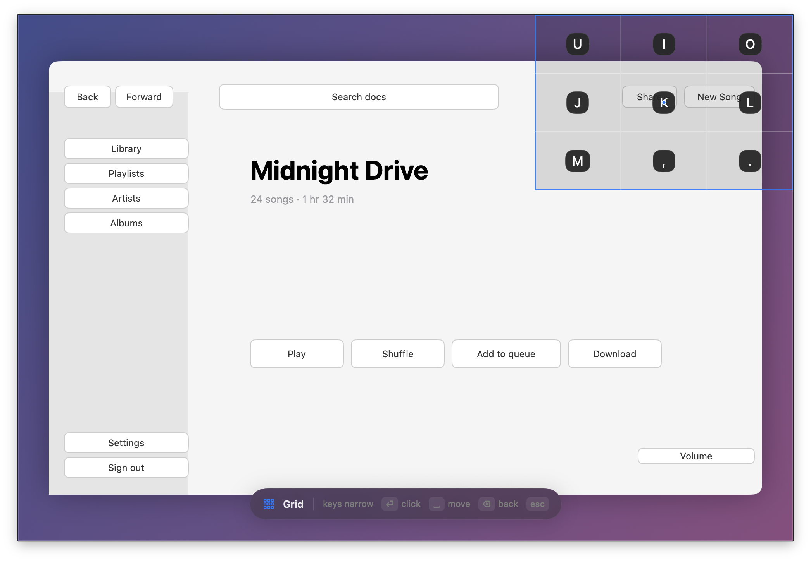
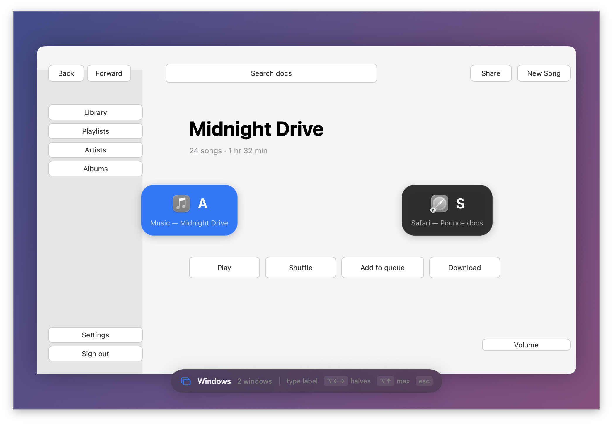
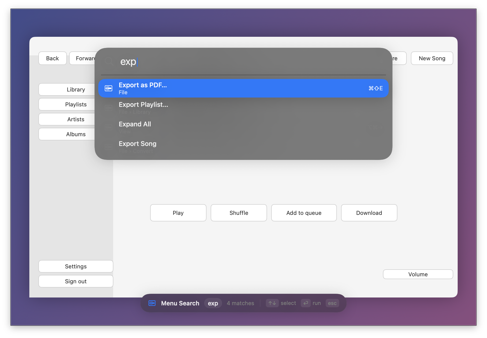
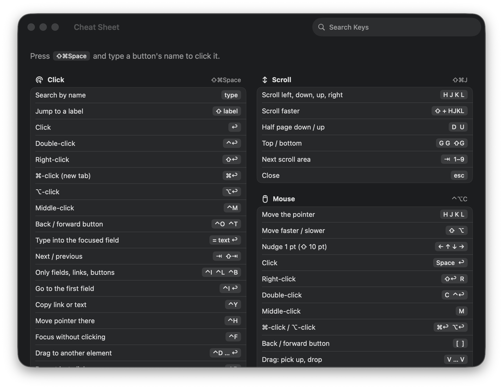

<p align="center">
  
</p>

<h1 align="center">Pounce</h1>

<p align="center">Click, scroll and switch windows on macOS without touching the mouse.<br>
Free and open source. Works in native apps, Safari, Chrome, Firefox and Electron apps.</p>

<p align="center">
  <a href="https://github.com/jaeaeich/pounce/releases/latest">Download</a> ·
  <a href="docs/INSTALL.md">Install options</a> ·
  <a href="#keys">Keys</a>
</p>



Press **⇧⌘Space**, type a few letters of what you want to click, press **↩**.

## What it does

| | |
|---|---|
| **Click** · ⇧⌘Space<br>Every button, link and field gets a label. Type its name or its label to click it. |  |
| **Scroll** · ⇧⌘J<br>Smooth `hjkl` scrolling in any scroll area, half pages, top and bottom. |  |
| **Grid** · ⌃⌥G<br>Click anywhere on screen, even in apps with nothing to label. |  |
| **Windows** · ⌃⌥W<br>Jump to any window, snap it to half the screen or move it to another display. |  |
| **Menu search** · ⌃⌥M<br>Search every menu command of the front app and run it. |  |

Also: **Mouse** mode (⌃⌥C) to steer the pointer with `hjkl`, **Text** mode (⌃⌥T) to click any word on screen, and **Repeat** to click the last target again.

## Install

```sh
brew install --cask jaeaeich/tap/pounce
```

Or download the DMG from [Releases](https://github.com/jaeaeich/pounce/releases/latest). Requires macOS 14 or later. On first launch, Pounce asks for Accessibility permission and walks you through a short practice.

Nix, nix-darwin, Home Manager and building from source: [docs/INSTALL.md](docs/INSTALL.md).

## Keys

In click mode:

| Key | Action |
|---|---|
| type | search by name |
| ⇧ + label | click that label |
| ↩ · ⇧↩ · ⌘↩ · ⌃↩ | click · right-click · ⌘-click · double-click |
| ⇥ · ⇧⇥ | next · previous match |
| ⌃Y | copy the link or text |
| ⌃D … ↩ | drag one element onto another |
| ? | show what an element is searchable as |
| esc | close |

The full list is in the menu bar under **Cheat Sheet**.



## Coming from another app

Settings → General → **Works like** matches the keys of Homerow, Shortcat, Vimium, Mouseless or Scoot. **Import from…** copies your existing settings, as does `pounce import <app>` in the terminal.

## Settings

Everything is in **Settings** in the menu bar: shortcuts, label letters, theme, per-app rules and a Caps Lock → Hyper key. Settings are stored in `~/.config/pounce/config.toml`, which you can also edit by hand; it reloads automatically.

Pounce can be controlled from scripts and launchers: `pounce hint`, `pounce scroll`, `pounce status` (see `pounce help`), or `open pounce://hint`.

## License

[MIT](LICENSE)
