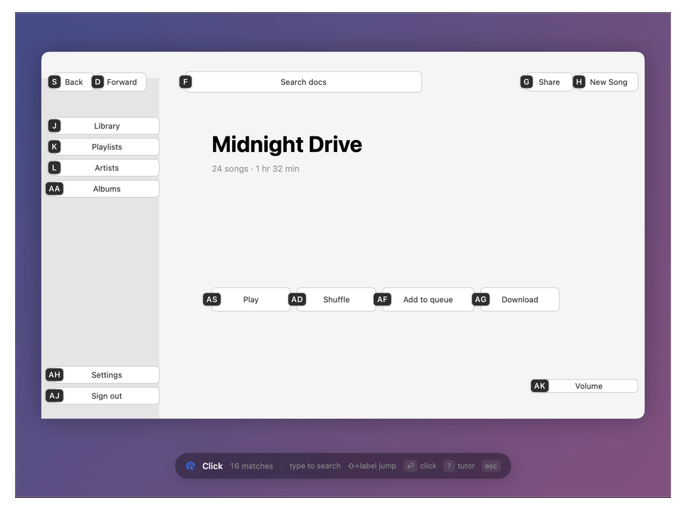
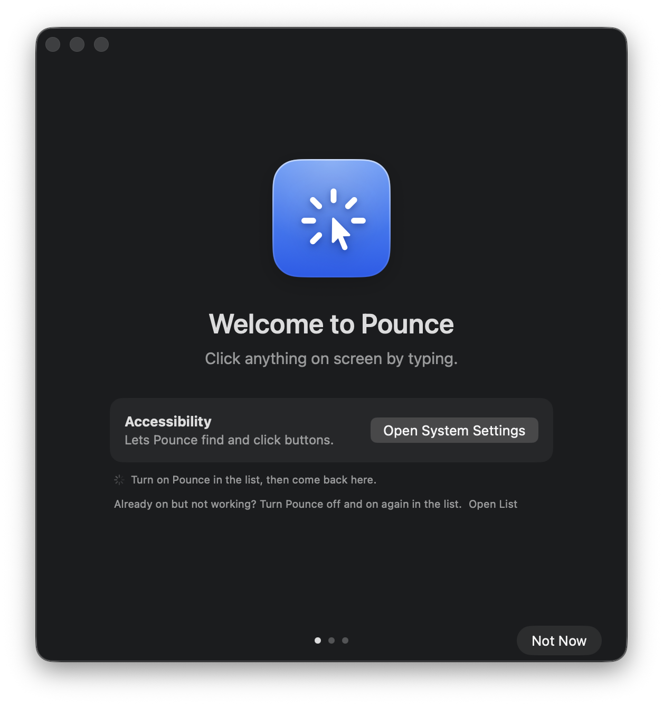
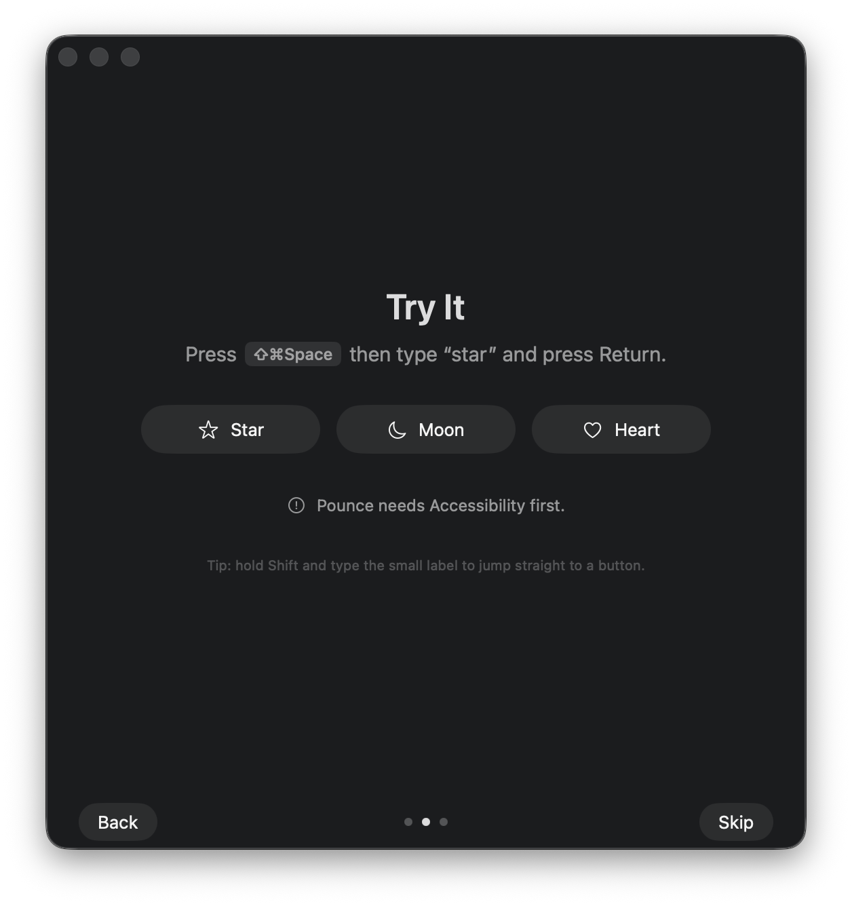
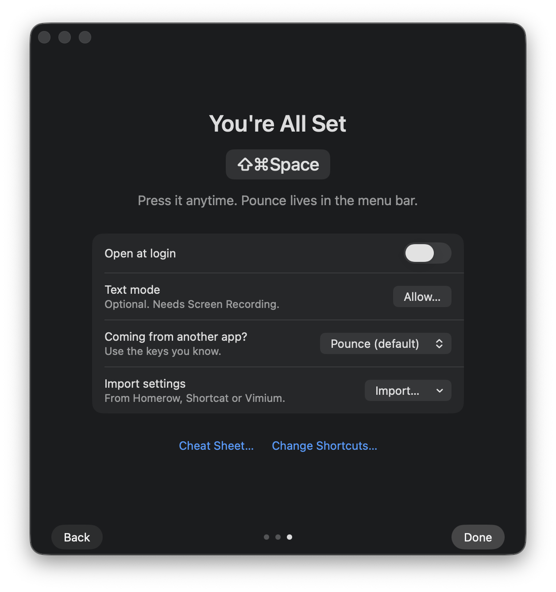
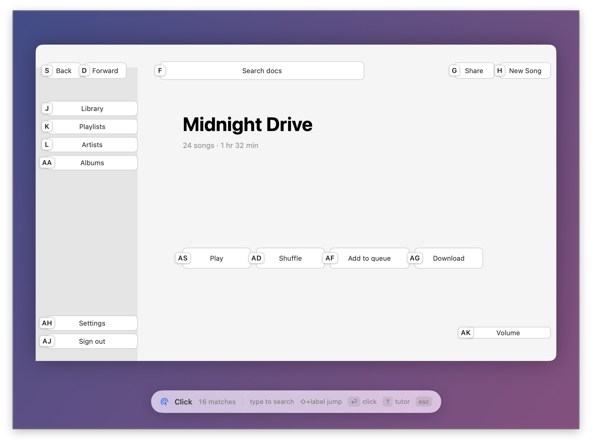
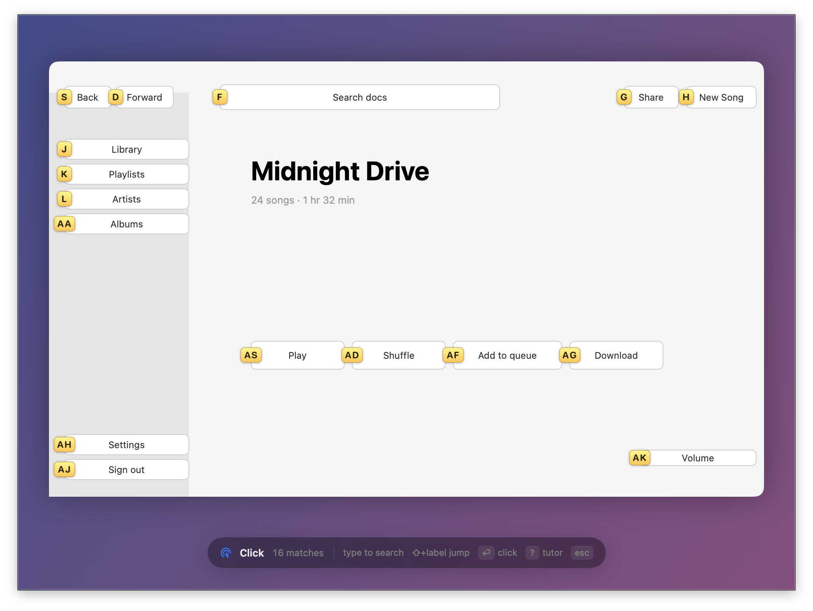

<p align="center">
  
</p>

<h1 align="center">Pounce</h1>

<p align="center">
  <b>Your Mac, without the mouse.</b><br>
  Click any button, scroll any page and jump to any window, straight from the keyboard.
</p>

<p align="center">
  <a href="https://github.com/JaeAeich/pounce/actions/workflows/ci.yml"></a>
  <a href="https://github.com/JaeAeich/pounce/releases/latest"></a>
  
  
  <a href="LICENSE"></a>
</p>

<p align="center">
  <a href="#install"><b>Install</b></a> ·
  <a href="#everything-it-does">Features</a> ·
  <a href="#keys">Keys</a> ·
  <a href="#coming-from-homerow-shortcat-or-vimium">Switching</a>
</p>

<p align="center">
  
</p>

<p align="center"><sub>Press <kbd>⇧</kbd><kbd>⌘</kbd><kbd>Space</kbd>, type a few letters of what you want, press <kbd>↩</kbd>. That's it.</sub></p>

---

## Why Pounce

- **Instant.** Pounce keeps an eye on the front window, so labels are usually ready before you press the shortcut. Typing filters thousands of elements without a stutter.
- **Works where you work.** Native apps, Safari, Chrome, Brave, Arc, Edge, Firefox, Zen, and Electron apps like Slack and VS Code.
- **Builds muscle memory.** A button keeps the same label every time, and the things you click most get the shortest ones.
- **Native and quiet.** A tiny menu bar app in Swift, no Electron. Your app never loses focus. No tracking; the only network request is an optional daily update check.
- **Free and open source.** No license keys, no subscription.

## Everything it does

<table>
  <tr>
    <td width="50%"></td>
    <td width="50%"></td>
  </tr>
  <tr>
    <td><b>Click</b> <kbd>⇧⌘Space</kbd><br>Every button, link and field gets a label. Type its name or its label to click it.</td>
    <td><b>Scroll</b> <kbd>⇧⌘J</kbd><br>Smooth <code>hjkl</code> scrolling in any scroll area, with half pages and jumps to the top or bottom.</td>
  </tr>
  <tr>
    <td></td>
    <td></td>
  </tr>
  <tr>
    <td><b>Windows</b> <kbd>⌃⌥W</kbd><br>Jump to any window, even hidden or minimized ones. Snap it to half the screen or another display.</td>
    <td><b>Menu search</b> <kbd>⌃⌥M</kbd><br>Search every menu command of the front app and run it, shortcuts included.</td>
  </tr>
  <tr>
    <td></td>
    <td></td>
  </tr>
  <tr>
    <td><b>Grid</b> <kbd>⌃⌥G</kbd><br>Click anywhere on screen, even in games, canvases and apps with nothing to label.</td>
    <td><b>Cheat sheet</b><br>Every key, one click away in the menu bar. Searchable.</td>
  </tr>
</table>

**And more:** steer the pointer with <code>hjkl</code> in **Mouse** mode (<kbd>⌃⌥C</kbd>), click any word on screen with **Text** mode (<kbd>⌃⌥T</kbd>), **repeat** your last click from anywhere, label **every window** at once, type into a field straight from search, and turn **Caps Lock into a Hyper key**.

## Install

```sh
brew install --cask jaeaeich/tap/pounce
```

Or grab the DMG from [Releases](https://github.com/JaeAeich/pounce/releases/latest). Pounce runs on macOS 14 Sonoma or later, on Apple silicon and Intel.

<table>
  <tr>
    <td width="33%"></td>
    <td width="33%"></td>
    <td width="33%"></td>
  </tr>
  <tr>
    <td align="center"><sub>1. Allow Accessibility</sub></td>
    <td align="center"><sub>2. Try it on practice buttons</sub></td>
    <td align="center"><sub>3. You're set</sub></td>
  </tr>
</table>

Nix, nix-darwin, Home Manager and building from source are covered in [docs/INSTALL.md](docs/INSTALL.md).

## Keys

Once labels are showing:

| Press | To |
|---|---|
| any letters | search by name |
| <kbd>⇧</kbd> + label | click that label |
| <kbd>↩</kbd> | click |
| <kbd>⇧</kbd><kbd>↩</kbd> · <kbd>⌘</kbd><kbd>↩</kbd> · <kbd>⌃</kbd><kbd>↩</kbd> | right-click · open in new tab · double-click |
| <kbd>⇥</kbd> · <kbd>⇧</kbd><kbd>⇥</kbd> | next · previous match |
| <kbd>⌃</kbd><kbd>Y</kbd> | copy the link or text |
| <kbd>esc</kbd> | close |

## Make it yours

<table>
  <tr>
    <td width="33%"></td>
    <td width="33%"></td>
    <td width="33%"></td>
  </tr>
</table>

Pick a theme and label size, change any shortcut (including single modifier taps like <kbd>right ⌘</kbd>), choose which letters labels use, and set rules per app. Everything lives in **Settings**, and in `~/.config/pounce/config.toml` if you'd rather edit text.

## Coming from Homerow, Shortcat or Vimium?

Settings → General → **Works like** switches Pounce to the keys you already know: Homerow, Shortcat, Vimium, Mouseless or Scoot. **Import from…** brings your existing settings along.

## Scripting

Every mode is one command away, for Raycast, Alfred, Karabiner or skhd:

```sh
pounce hint       # or scroll, grid, windows, menu, text, mouse
pounce repeat     # click the last target again
pounce status     # permissions, shortcuts, Secure Input
open pounce://windows
```

---

<p align="center">
  <a href="CONTRIBUTING.md">Contributing</a> · <a href="docs/INSTALL.md">Install guide</a> · <a href="CHANGELOG.md">Changelog</a> · <a href="LICENSE">MIT License</a>
</p>
